# 01. Preparation

!!! abstract "Goal"
    Access the dCloud environment, start the lab, and open a device console.

## 1.1 Open the lab session

1. Open the lab-access email supplied for your dCloud session.

    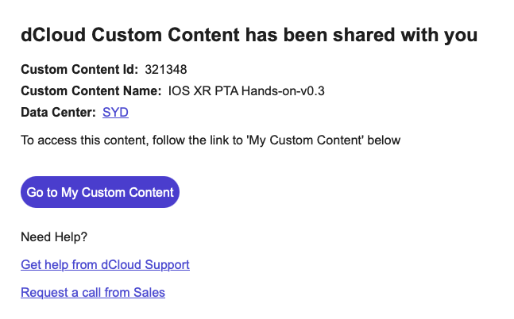

2. Alternatively, open [Cisco dCloud](https://dcloud.cisco.com/), sign in with your email address, and select **My Hub**.

    

3. Select **SYD ANZ Datacenter**.

    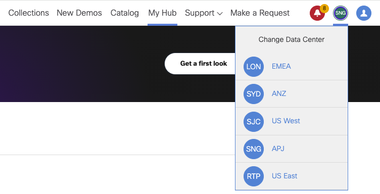

4. Select **Sessions**, then **View**.

    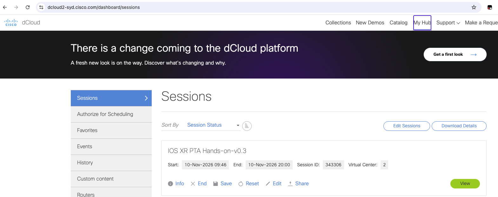

5. Review the session view.

    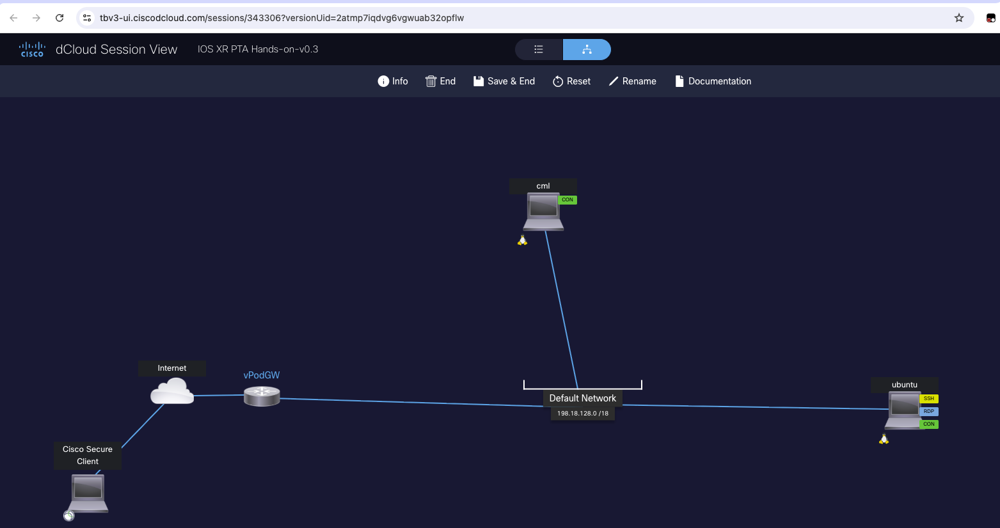

## 1.2 Start the lab

1. Select **Ubuntu**.

    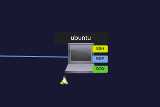

2. Select **Remote Access**, then **VM Console** on the left. Sign in with the supplied lab credentials.
3. Right-click **Chromium Web Browser** and select **Launch (Execute)**.
4. Select **Login::CML2**.

    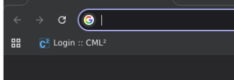

5. Sign in with the supplied Cisco Modeling Labs credentials, then select **Cisco Modeling Labs**.

    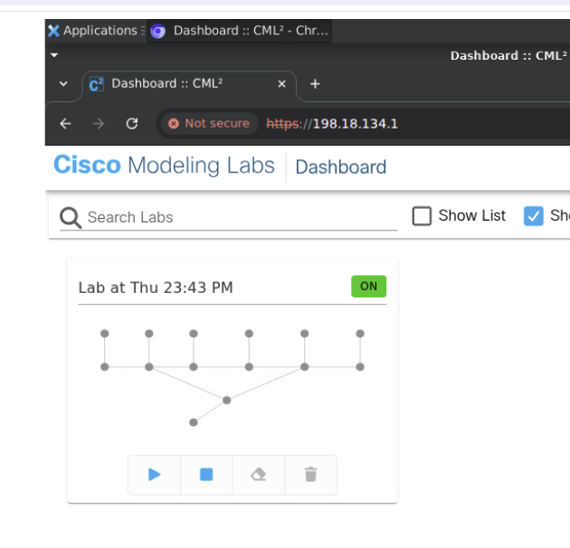

6. Start the lab.

    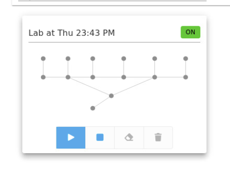

7. Wait five minutes for the devices to boot, then select the topology.

    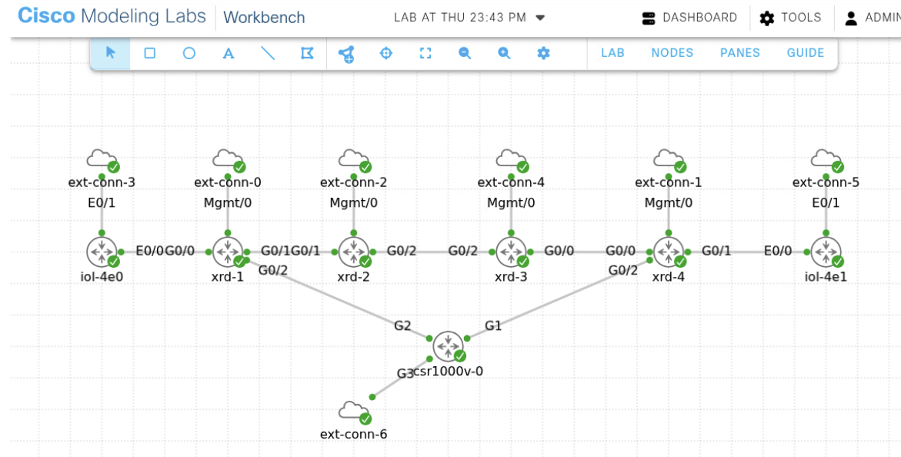

| Parameter | Value | Notes |
| --- | --- | --- |
| Datacenter | `SYD ANZ Datacenter` | Select in dCloud |
| Ubuntu credentials | `<username>` / `<password>` | Use the supplied access details |
| Cisco Modeling Labs credentials | `<username>` / `<password>` | Use the supplied access details |
| Boot wait | `5 minutes` | After starting the lab |

## 1.3 Open a device console

1. Right-click a device and select **Console**.

    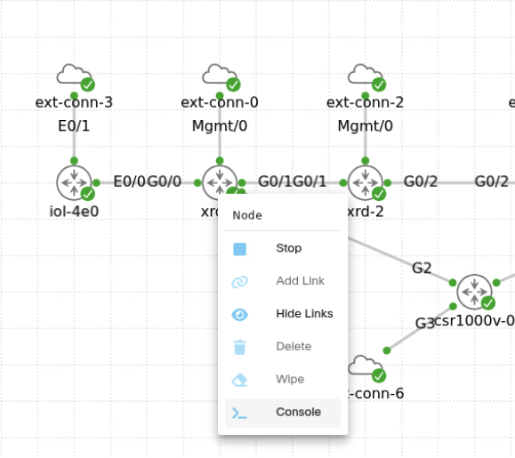

2. Sign in using the supplied device credentials and begin the exercises.

    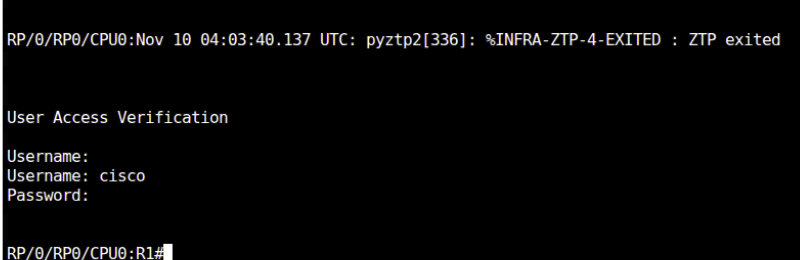

!!! tip
    If a router hangs during an exercise, stop and start that device.

## Next step

Continue with [02. Commit configuration](../02-commit-configuration/index.md).