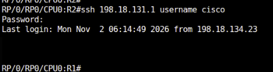
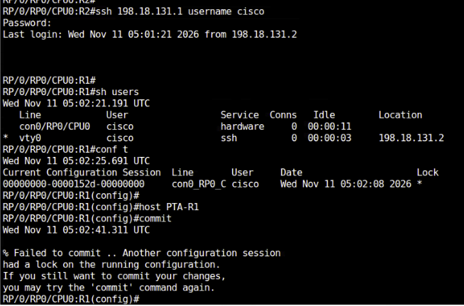

# 02. Commit configuration

!!! abstract "Goal"
    Stage and commit IOS XR configuration changes. Practise labeled, best-effort, and confirmed commits, exclusive configuration sessions, and rollback.

## 2.1 Commit

The target configuration contains changes made in configuration mode before they are applied to the active configuration. Committing makes the changes part of the running configuration.

1. Change the hostname of `R1` to `PE-1`.
2. Inspect the target configuration with `show` or `show config`.
3. Commit the change.

```text
RP/0/RP0/CPU0:R1(config)#host PE-1
RP/0/RP0/CPU0:R1(config)#
RP/0/RP0/CPU0:R1(config)#show
Wed Nov 11 05:19:40.354 UTC
!! Building configuration...
!! IOS XR Configuration 26.1.1
hostname PE-1
end
RP/0/RP0/CPU0:R1(config)#show config
Wed Nov 11 05:19:43.928 UTC
!! Building configuration...
!! IOS XR Configuration 26.1.1
hostname PE-1
end
RP/0/RP0/CPU0:R1(config)#commit
Wed Nov 11 05:19:58.772 UTC
RP/0/RP0/CPU0:PE-1(config)#
```

!!! note
    Subsequent source captures use the hostname `R1`, even though this exercise changes it to `PE-1`.

## 2.2 Commit with a label

A descriptive commit label helps identify the changes later.

1. Configure the loopback interface.
2. Inspect the target configuration.

```text
RP/0/RP0/CPU0:R1(config)#int lo11
RP/0/RP0/CPU0:R1(config-if)#ip address 11.11.11.11/32
RP/0/RP0/CPU0:R1(config-if)exit
RP/0/RP0/CPU0:R1(config)#
RP/0/RP0/CPU0:R1(config)#show
Wed Oct 28 05:53:23.345 UTC
!! Building configuration...
!! IOS XR Configuration 26.1.1
interface Loopback11
 ipv4 address 11.11.11.11 255.255.255.255
!
end
RP/0/RP0/CPU0:R1(config)#
```

3. Commit with the supplied label, then verify the running configuration.

```text
RP/0/RP0/CPU0:R1(config)#commit label ?
  WORD  Label for this commit (must begin with an alphabet)
RP/0/RP0/CPU0:R1(config)#commit label ADDEDLOOPBACK0
Wed Oct 28 05:55:31.421 UTC
RP/0/RP0/CPU0:R1(config)#end
RP/0/RP0/CPU0:R1#sh running-config interface lo11
Wed Oct 28 05:57:47.885 UTC
interface Loopback11
 ipv4 address 11.11.11.11 255.255.255.255
!
RP/0/RP0/CPU0:R1#
```

| Parameter | Value | Notes |
| --- | --- | --- |
| Interface | `lo11` | Source loopback interface |
| Address | `11.11.11.11/32` | Loopback address |
| Commit label | `ADDEDLOOPBACK0` | Label shown in the source |

!!! warning "Source caveat"
    The source prompt before `exit` is missing `#`. The CLI sample is preserved as supplied.

## 2.3 Commit best-effort

An atomic commit fails if any configuration item has a semantic error. `commit best-effort` applies valid configuration items even when others fail.

1. Enter the supplied class-map and policy-map configuration, then attempt the commit.

```text
class-map DATA_1
 match dscp AF11
 exit

 class-map DATA_2
  match dscp AF21
  exit

policy-map CBWFQ
 class DATA_1
  bandwidth percent 10

 class DATA_3
  bandwidth percent 20
commit
```

2. Observe the commit error.
3. Use `show` or `show config` in global configuration mode to inspect the target configuration.
4. Run `show configuration failed` to inspect the failure.
5. Run `commit best-effort` to apply the valid changes.
6. Use `show run class-map DATA_1` and `show run class-map DATA_2` to inspect the applied configuration.

!!! warning "Source caveat"
    The source does not include the failed-commit output.

## 2.4 Commit confirmed

`commit confirmed` applies changes temporarily and rolls them back unless a second commit confirms them. The source gives a default rollback timer of ten minutes; this exercise uses an explicit timer of 60 seconds.

1. Configure the loopback and issue the confirmed commit.

```text
int lo10
ip address 10.10.10.10/32

commit confirmed 60
```

2. Wait 60 seconds without issuing a second commit.
3. Use `sh run int lo10` to check that the loopback configuration rolled back. Alternatively, use `show configuration rollback changes last 1`.

| Parameter | Value | Notes |
| --- | --- | --- |
| Interface | `lo10` | Loopback for this exercise |
| Address | `10.10.10.10/32` | Temporary configuration |
| Timer | `60 seconds` | Rollback unless confirmed |

!!! note
    To retain the changes instead, issue a second `commit` within 60 seconds.

## 2.5 Configure exclusive

An exclusive configuration session prevents other sessions from committing changes while its lock is active. Other users can still prepare target configurations.

1. Sign in to `R1` as `cisco` with password `<password>`.
2. Establish an exclusive session with `config exclusive`.
3. From the `R2` console, connect to `R1` using SSH.

    

4. Sign in with the `cisco` account and password `<password>`. Attempt a configuration change and commit it; observe the behaviour.

    

## 2.6 Rollback

IOS XR retains a history of committed configurations. Use a label or a previous commit to revert the running configuration without restoring each command manually.

1. Use `rollback configuration last 1` to roll back to the previous commit.
2. Inspect the available commit and operational history with the source commands below.

| Parameter | Value | Notes |
| --- | --- | --- |
| Commit count | `<Number of commits>` | Number of commits to inspect |

```text
Show configuration commit changes last <Number of commits>
show configuration commit list
show cli history detail
```

- Use the commit-change command to view configuration changes since the specified number of commits.
- Use the commit list to inspect previous commits.
- Use CLI history to view executed commands.

!!! warning "Source caveat"
    The source does not include rollback or operational-history output.

## Next step

Continue with [03. Operations and monitoring](../03-operations-and-monitoring/index.md).