# 03. Operations and monitoring

!!! abstract "Goal"
    Inspect IOS XR processes and memory, filter command output, and collect diagnostic information. Practise task-group authorization and inspect interface and LPTS information.

## 3.1 Process management

| Parameter | Value | Notes |
| --- | --- | --- |
| Process | Executable code in its own memory space | May contain threads |
| Thread | Sub-process, such as an ISIS hello-handling thread | Runs when its parent is allocated runtime |
| Job ID | `JID` | Remains associated with the process after restart |
| Process ID | `PID` | Changes after restart |
| Thread ID | `TID` | Associated with the process PID/JID |

1. Display the ISIS process and note its IDs.

```text
RP/0/RP0/CPU0:R1#show processes isis
Thu Oct 29 00:43:33.528 UTC
                  Job Id: 1003
                     PID: 16870
            Process name: isis
```

2. Restart it with `process restart isis`.
3. Display the process again and compare the IDs. The source notes that the job ID stays the same while process and thread IDs change.

!!! warning "TODO"
    The source alternates between `show processes isis` and `show process isis`; verify the accepted spelling on the lab image. No post-restart output is supplied.

## 3.2 Monitor processes

`monitor processes` provides Unix `top`-like CPU, memory, and process information, refreshed every ten seconds.

1. Run `monitor processes` and identify the processes consuming the most CPU.
2. Enter `?` to inspect the interactive commands.
3. Use `n` to change the number of displayed entries.

    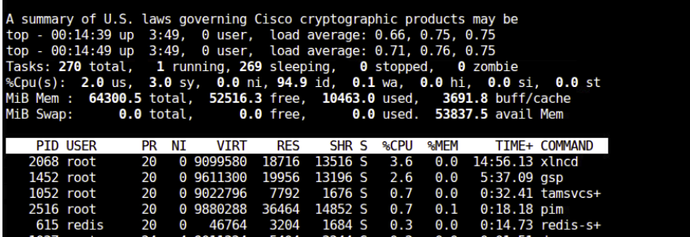

4. Run `show process location 0/RP0/CPU0` to inspect the processes on the CPU.

    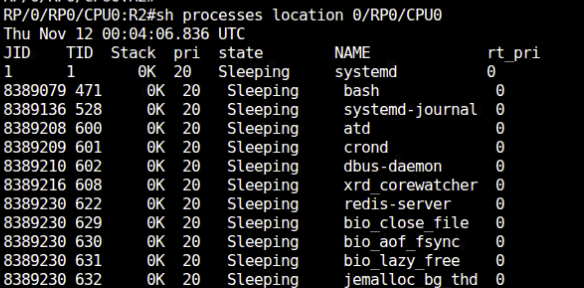

5. Run `show process blocked location <location>` several times to check for blocked processes.

    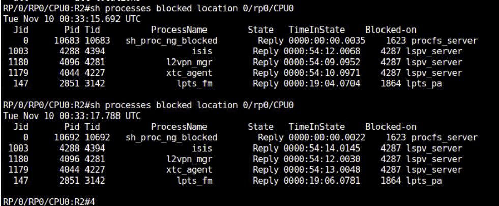

| Parameter | Value | Notes |
| --- | --- | --- |
| Refresh interval | `10 seconds` | Monitor display |
| Location | `0/RP0/CPU0` | Source route-processor location |
| Entry control | `n` | Number of displayed entries |

## 3.3 Memory leak detection

A memory leak occurs when a process allocates memory but does not return it when no longer needed. Compare two snapshots around a trigger to inspect allocation differences.

1. Take a baseline snapshot.

    ```text
    show memory compare start
    ```

    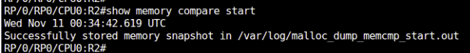

2. Execute the trigger: restart the ISIS process or relearn BGP routes.

    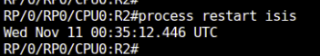

3. Take the second snapshot.

    ```text
    show memory compare end
    ```

    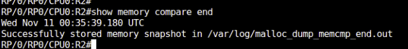

4. Generate the difference report.

    ```text
    show memory compare report
    ```

    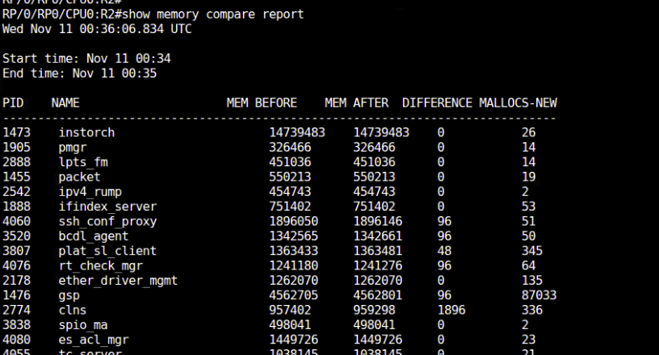

5. Repeat the comparison and inspect the `DIFFERENCE` column for a process that is not freeing memory.
6. Inspect the other memory summaries supplied in the source.

```text
show memory summary
show memory summary detail location all
```

## 3.4 Multipipe support

IOS XR supports up to eight pipes to filter and format show-command output.

1. Use multiple pipes to extract the required information from a show command.

    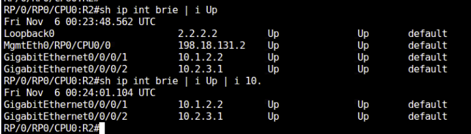

## 3.5 Describe command

`describe` exposes command internals, required privileges, and background processing details.

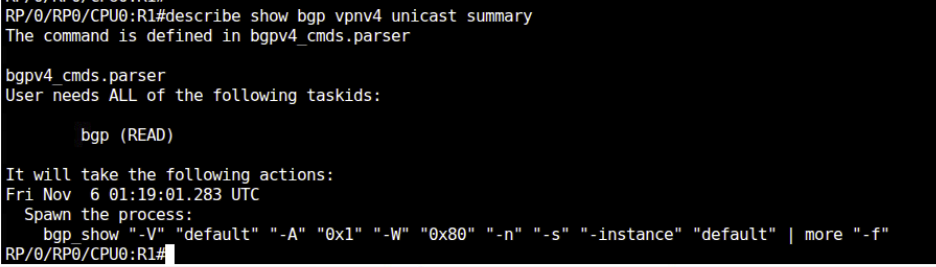

1. Execute `show bgp vpn4 unicast summary` or another command from the lab.
2. Append `describe` and execute it again.
3. Observe the required privileges.
4. Note the CLI under **Spawn the Process**.
5. Execute `run` to enter the underlying Linux shell.
6. Execute the CLI listed under **Spawn the Process** and observe the output.

!!! warning "TODO"
    Verify the source spelling `vpn4` against the lab CLI. The source does not supply output for the spawned-process step.

## 3.6 Trace functionality

IOS XR traces provide persistent diagnostic logging for daemons, protocols, and hardware without enabling disruptive real-time debugs.

1. Run `show isis trace severe` or `show bgp trace` and inspect the logs.

    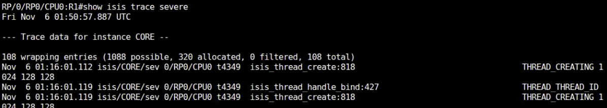

2. Add `tailf` to view the latest debug information.

## 3.7 Show tech-support

`show tech-support` collects diagnostic information into bundled, compressed files on the router's disk. Collection can also target a particular module.

1. Inspect the source examples for module-specific collection.

    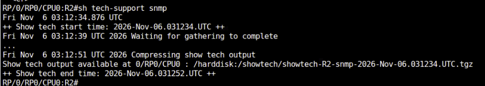

    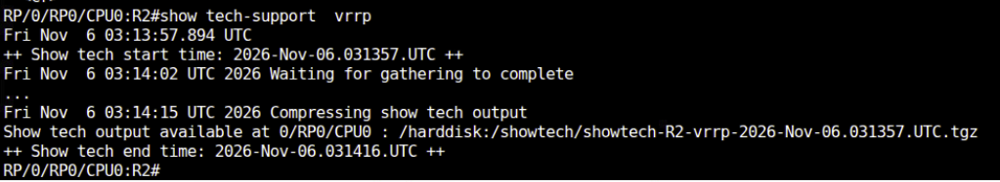

## 3.8 Task groups

IOS XR uses task groups for authentication and authorization rather than IOS-style privilege levels. Use a system-defined user group or define a task group with granular permissions.

### Exercise 3.8.1: System-defined group

1. Create `user1` and bind it to `operator`.

```text
username user1
 group operator
 secret <password>
```

2. Sign in as `user1` and test the source commands.

```text
Show ver
Show bgp ?
```

3. Use `exit` to sign out, then sign back in with the supplied lab account.

    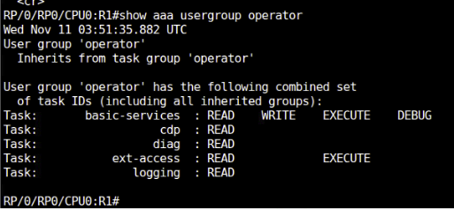

### Exercise 3.8.2: Custom task group

1. Define `ISISREAD` with read permission for ISIS.
2. Define `LEVEL_1` and bind the task group.
3. Create `user2` and bind it to `LEVEL_1`.

```text
taskgroup ISISREAD
 task read isis

usergroup LEVEL_1
 taskgroup ISISREAD

username user2
 group LEVEL_1
 secret <password>
```

4. Sign out, sign in as `user2`, and inspect its permissions.

    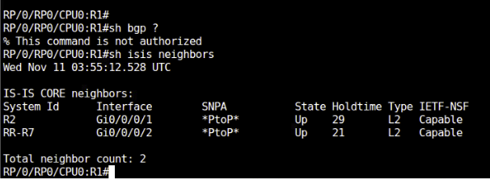

| Parameter | Value | Notes |
| --- | --- | --- |
| System-group user | `user1` | Bound to `operator` |
| Custom-group user | `user2` | Bound to `LEVEL_1` |
| Task group | `ISISREAD` | `task read isis` |
| Secret | `<password>` | Supply a lab password locally |

5. Inspect authentication and group privileges with the source commands.

```text
show user authentication method
show aaa usergroup <operator>
show aaa usergroup <level_1 >
```

!!! note
    The source identifies `cisco-support` as the highest-privilege group.

!!! warning "TODO"
    The source uses both `LEVEL_1` and `level_1`, and includes angle brackets around group names in the inspection commands. Verify the intended syntax on the lab image.

## 3.9 Run and attach

1. Execute `run` from EXEC mode to enter the underlying Linux Bash shell.

    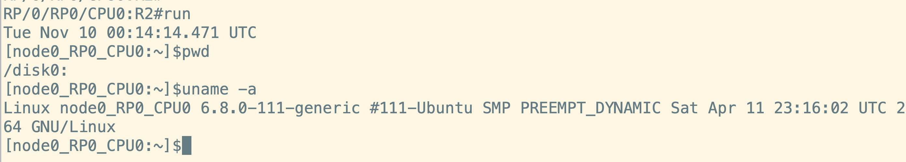

2. Use `exit` to return to the IOS XR CLI.
3. Review the `attach` example for a multi-line-card chassis.

    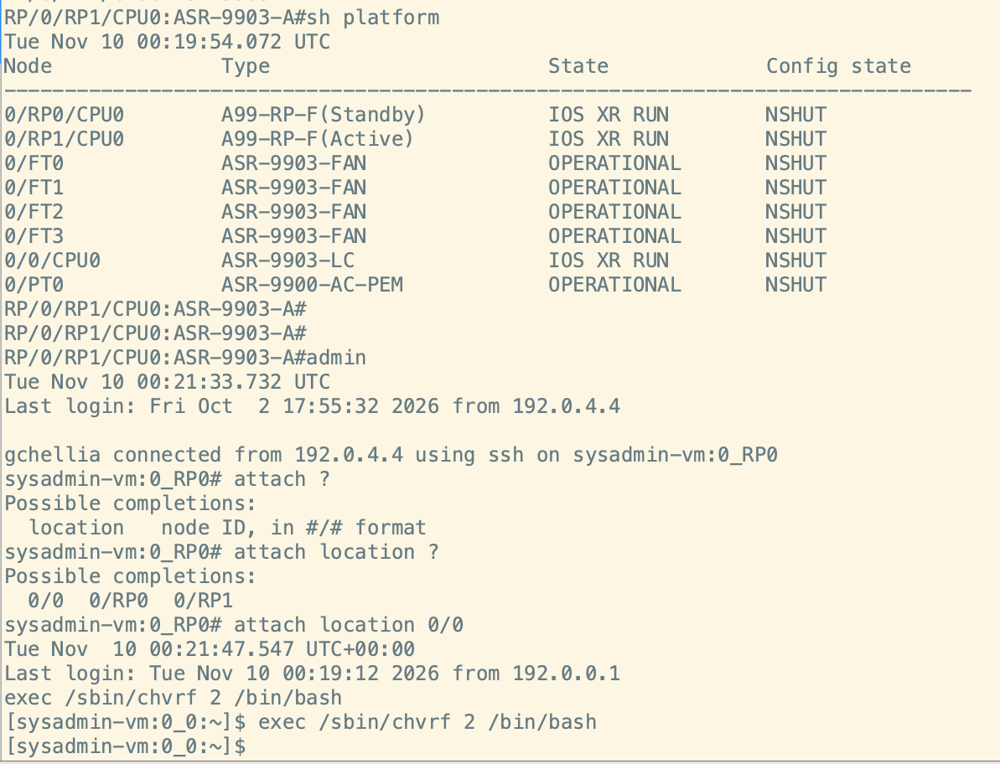

!!! note
    `attach` operates from admin mode on a multi-line-card chassis. It is not available in this virtual XRd lab; the example is for reference.

## 3.10 Interface troubleshooting

1. Use `show controllers <interface-name> all` to inspect low-level interface and controller diagnostics.

    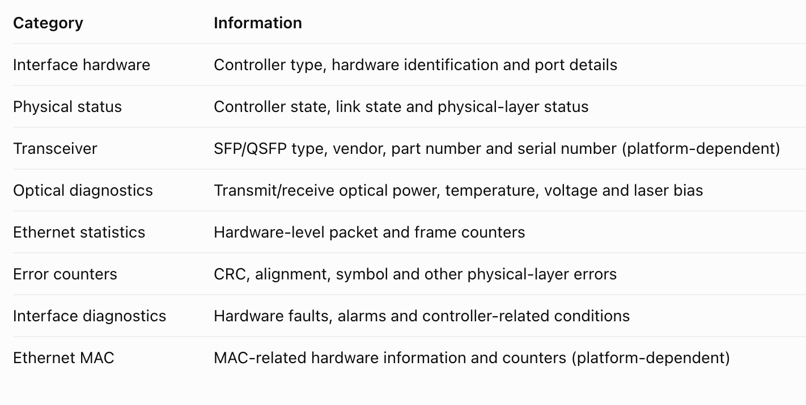

    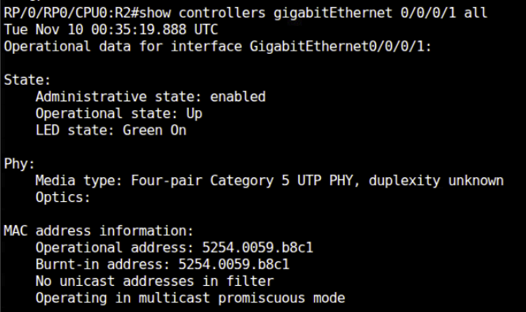

2. Compare the output with the source capture from physical `8202` hardware.

    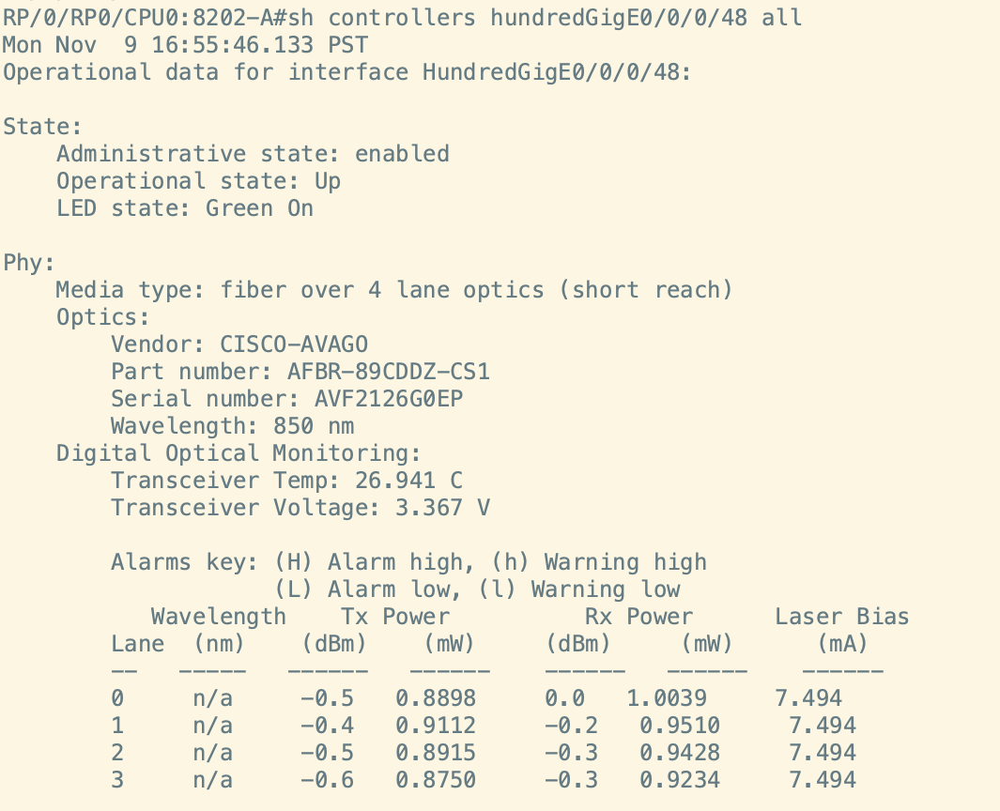

## 3.11 Local Packet Transport Services

Local Packet Transport Services (LPTS) provides firewall and policing functionality for traffic destined for the router. It filters and polices packets by flow type before delivering them to software to avoid overwhelming the CPU.

1. Inspect the LPTS entries using the commands shown in the source captures.

    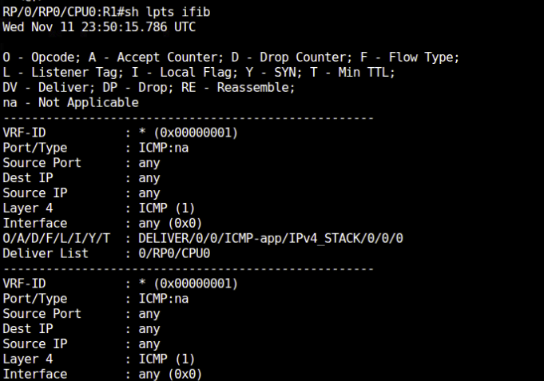

    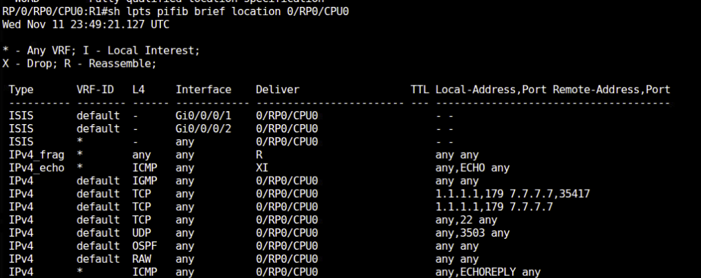

## Next step

Continue with [04. BGP](../04-bgp/index.md).