# 04. BGP

!!! abstract "Goal"
    Become familiar with BGP configuration and route policies in IOS XR, including the requirement to associate a routing policy with an eBGP peer to prevent accidental route acceptance or advertisement. If a route policy is not configured in the appropriate address family, received prefixes (NLRI, Network Layer Reachability Information) are discarded and no NLRIs are advertised to eBGP peers.

## 4.1 Topology and lab state

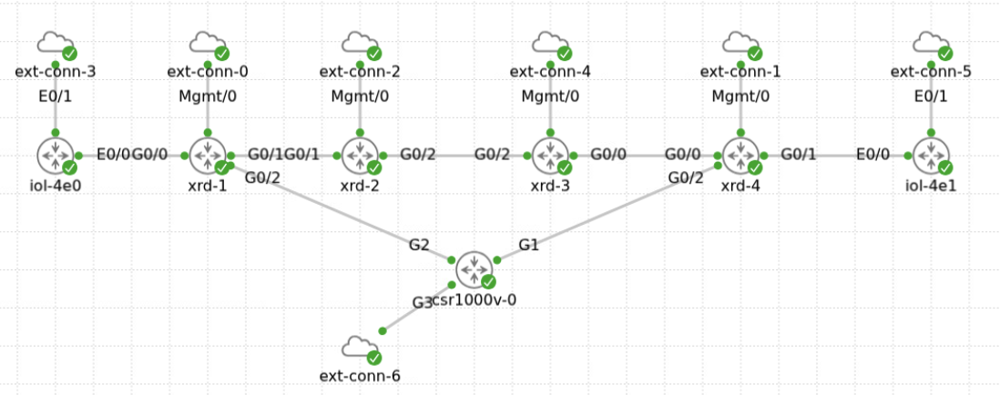

| No. | Router | Hostname | Role | Management IP |
| --- | --- | --- | --- | --- |
| 1 | `xrd-1` | `R1` | PE-1 (Provider Edge) | `198.18.131.1` |
| 2 | `xrd-2` | `R2` | P (Provider) | `198.18.131.2` |
| 3 | `xrd-3` | `R3` | P (Provider) | `198.18.131.3` |
| 4 | `xrd-4` | `R4` | PE-2 (Provider Edge) | `198.18.131.4` |
| 5 | `Iol-4e0` | `CE-1` | Customer Edge | `198.18.131.5` |
| 6 | `Iol-4e1` | `CE-2` | Customer Edge | `198.18.131.6` |
| 7 | `Csr-1000v` | `RR-R7` | Route Reflector | `198.18.131.7` |

!!! note
    The source lab starts with an L3VPN, an ISIS core, and OSPF between PE and CE. Segment routing is preconfigured without LDP. This chapter migrates PE-CE routing to BGP; no standalone ISIS/segment-routing exercise is included.

## 4.2 Establish PE-CE neighbors

| Parameter | Value | Notes |
| --- | --- | --- |
| Provider AS | `100` | PE-1 source configuration |
| CE-1 AS | `65101` | CE-1 source configuration |
| CE-2 AS | `65102` | Configure on CE-2 |
| VRF | `VPN_A` | Provider-side VRF |
| CE-1 prefix | `50.1.1.1/32` | Configure on `Loopback50` and advertise into BGP |
| CE-2 prefix | `51.1.1.1/32` | Configure on `Loopback100` and advertise into BGP |
| PE-1 neighbor | `172.16.1.2` | CE-1 address |
| CE-1 neighbor | `172.16.1.1` | PE-1 address |

1. Configure PE-1 using the supplied configuration.

```text
router bgp 100
 vrf VPN_A
  neighbor 172.16.1.2
   remote-as 65101
   address-family ipv4 unicast
```

2. Configure CE-1 and advertise its loopback.

```text
interface Loopback50
 ip address 50.1.1.1 255.255.255.255

router bgp 65101
 bgp log-neighbor-changes
 neighbor 172.16.1.1 remote-as 100
 network 50.1.1.1 mask 255.255.255.255
exit
```

3. Use `show bgp vrf VPN_A summary` to verify the neighbor. Observe the zero received prefixes and the `!` marker.

    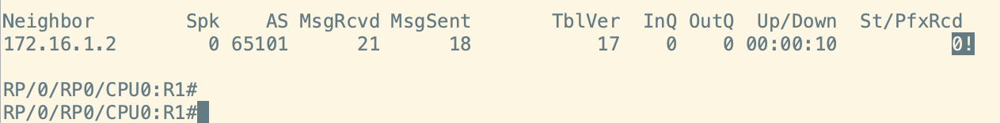

## 4.3 Apply an eBGP route policy

The source explains that IOS XR requires an eBGP route policy to accept and advertise routes. Without an inbound or outbound policy under the address family, routes are not accepted or advertised.

1. Define `PASS` and attach it in both directions on the PE-1 neighbor.

```text
route-policy PASS
  pass
end-policy

router bgp 100
 vrf VPN_A
  neighbor 172.16.1.2
   remote-as 65101
   address-family ipv4 unicast
    route-policy PASS in
    route-policy PASS out
```

2. Verify the neighbor and received routes again.

    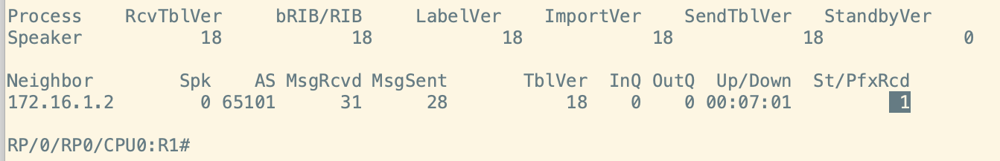

3. Configure eBGP between PE-2 and CE-2 and advertise `51.1.1.1/32` on CE-2 `Loopback100`, following the PE-1/CE-1 exercise.

    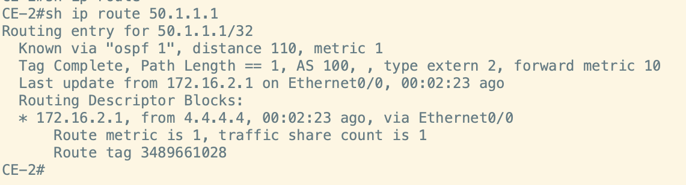

4. Verify connectivity from CE-2 to CE-1.

    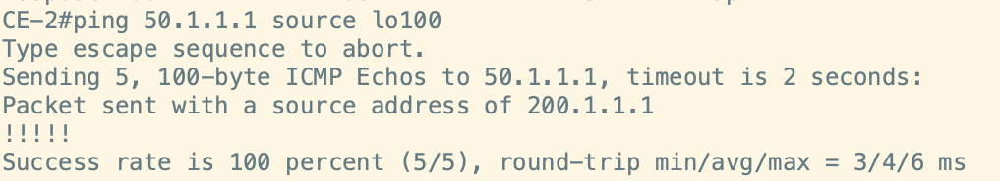

## 4.4 Filter a prefix with Route Policy Language

1. Create five loopbacks on CE-1 and advertise their networks into BGP.

```text
int lo61
ip address 60.1.1.1 255.255.255.0
int lo62
ip address 60.1.2.1 255.255.255.0
int lo63
ip address 60.1.3.1 255.255.255.0
int lo64
ip address 60.1.4.1 255.255.255.0
int lo65
ip address 60.1.5.1 255.255.255.0
router bgp 65101
network 60.1.1.0 mask 255.255.255.0
network 60.1.2.0 mask 255.255.255.0
network 60.1.3.0 mask 255.255.255.0
network 60.1.4.0 mask 255.255.255.0
network 60.1.5.0 mask 255.255.255.0
```

2. Verify that all prefixes appear in the R1 BGP VPNv4 table.

    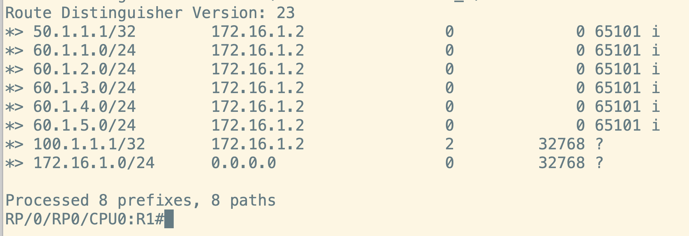

3. Write `FILTER_IN` to filter `60.1.3.0/24` without filtering the other prefixes.

    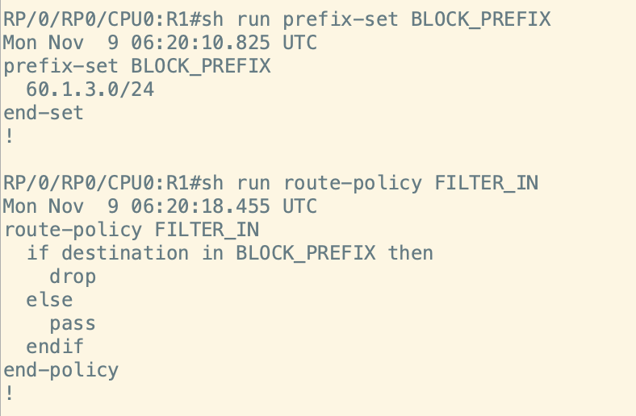

4. Attach `FILTER_IN` to neighbor `172.16.1.2`.

    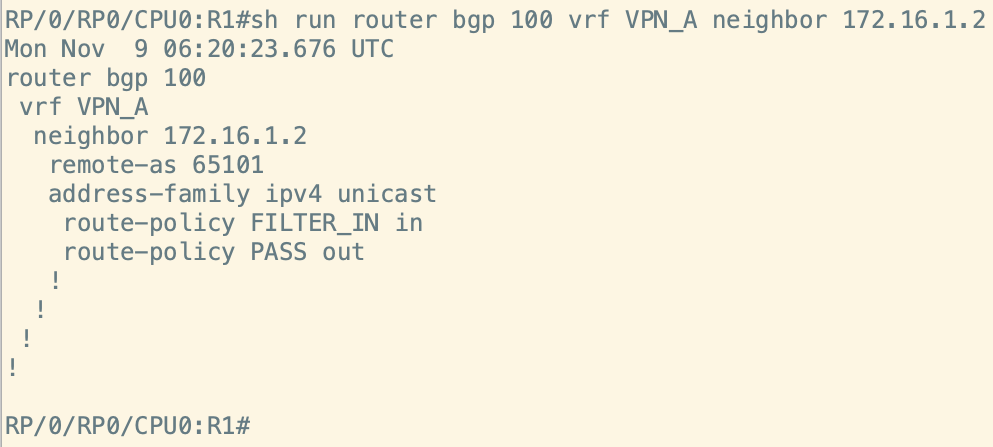

!!! tip
    The neighbor-specific configuration view shown in the source is useful when inspecting one neighbor among many.

5. Perform the source soft inbound clear after attaching the policy.

```text
RP/0/RP0/CPU0:R1#clear bgp vpnv4 unicast * soft in
```

6. Verify that `60.1.3.0/24` is absent from the BGP VPNv4 table.

    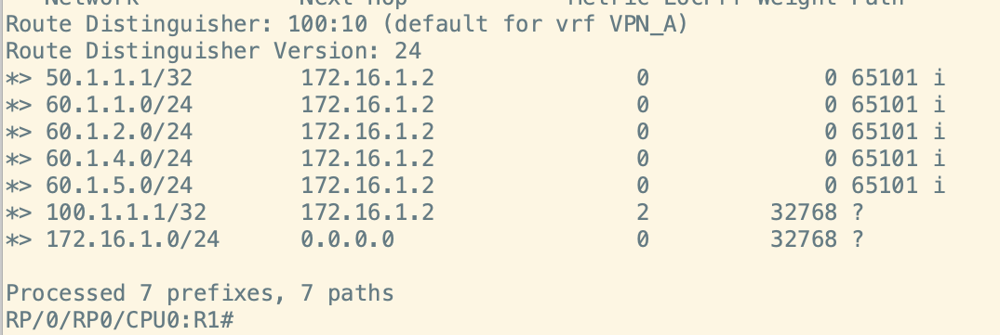

| Parameter | Value | Notes |
| --- | --- | --- |
| Loopbacks | `lo61` through `lo65` | CE-1 source interfaces |
| Advertised networks | `60.1.1.0/24` through `60.1.5.0/24` | Five source networks |
| Filtered prefix | `60.1.3.0/24` | Retain the other prefixes |
| Policy | `FILTER_IN` | Attach to `172.16.1.2` |

## 4.5 Edit a route policy in a text editor

1. Create the prefix set `BLOCK_PREFIX_5` and attach it to `FILTER_IN_5` using the editor workflow in the source captures.

    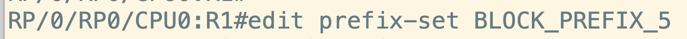

    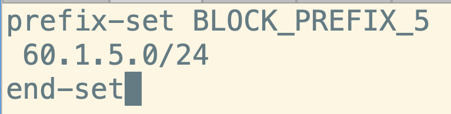

    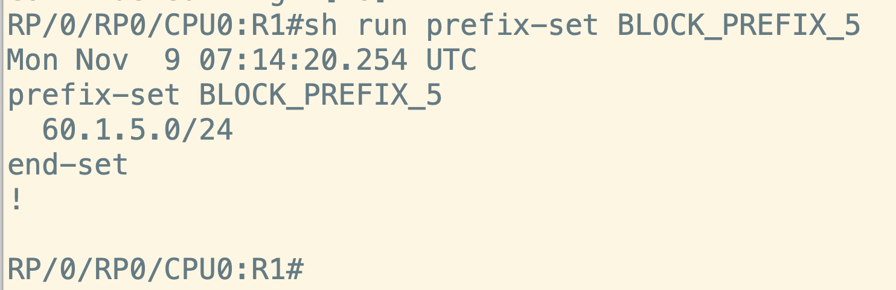

    

    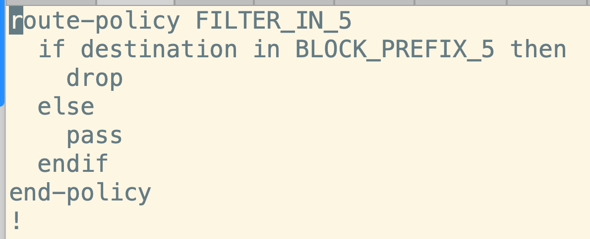

2. Review syntax validation and commit when the syntax is correct.

    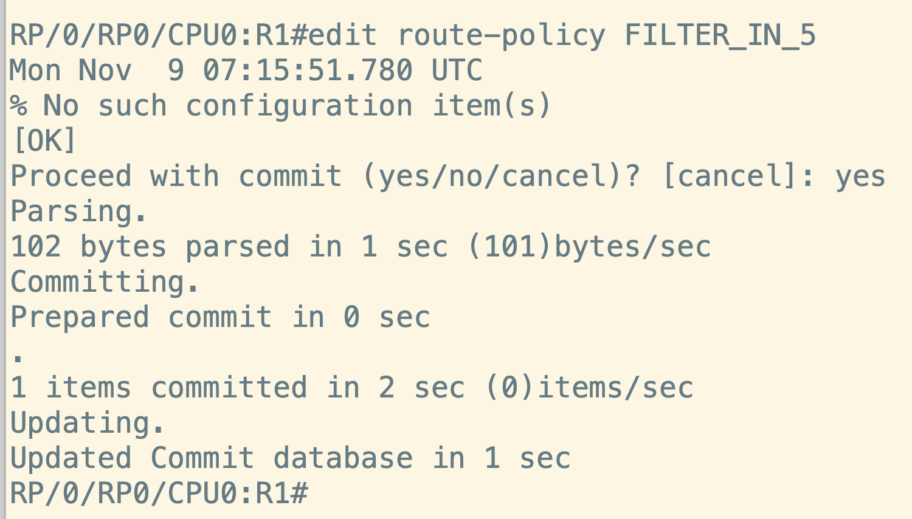

| Parameter | Value | Notes |
| --- | --- | --- |
| Prefix set | `BLOCK_PREFIX_5` | Source editor exercise |
| Route policy | `FILTER_IN_5` | Attach the prefix set |

## Next step

Return to the [guide overview](../index.md) to revisit an exercise.